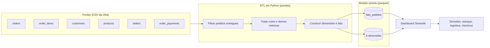

# Dashboard de decisão: Olist

**Projeto Integrador IV | Etapa 2**
Curso: Banco de Dados - SENAC EAD | Disciplina: Projeto Integrador - Ciência de Dados Aplicada a Situação de Mercado

**Integrantes**
- Arno Wendt Filho
- David Calazans Tavares
- Julyana Mendes
- Paulo Augusto Silva Amorim
- Rafaella Silva
- Rhayane Bernardino Souza Leão

**Dashboard publicado:** [abrir o app no Streamlit Cloud](https://dashboard-olist-pi.streamlit.app/).

---

## Problema de negócio

A Olist é um marketplace brasileiro de e-commerce. Para decidir sobre estoque, marketing, logística e
checkout, o time precisa enxergar vendas e entregas de forma integrada, mas os dados originais estão
espalhados em várias tabelas. Este projeto organiza os dados em um modelo analítico e entrega um
dashboard que responde:

> Onde estão as oportunidades de venda e os riscos de atraso na entrega?

Na Etapa 1 foi feita a análise exploratória (`notebooks/01_analise_exploratoria_etapa1.ipynb`) com cinco
visualizações. A Etapa 2 executa o que foi planejado: transforma os dados em um modelo estrela e publica
um dashboard interativo.

## Fonte de dados

[Brazilian E-Commerce Public Dataset by Olist](https://www.kaggle.com/datasets/olistbr/brazilian-ecommerce)
(Kaggle, licença CC BY-NC-SA 4.0): cerca de 100 mil pedidos feitos entre 2016 e 2018. O projeto usa 6 das 9 tabelas:
pedidos, itens, clientes, produtos, vendedores e pagamentos.

## Arquitetura



## Modelo estrela

| Tabela | Descrição |
|---|---|
| `fato_pedidos` | Grão: um item de pedido entregue. Medidas: preço, frete, receita, prazo de entrega, prazo estimado e dias de atraso |
| `dim_tempo` | Calendário contínuo (ano, mês, trimestre, dia da semana) |
| `dim_cliente` | Cliente do pedido, cidade e UF |
| `dim_produto` | Categoria, peso, dimensões e fotos |
| `dim_vendedor` | Vendedor, cidade e UF |
| `dim_pagamento` | Forma de pagamento e faixa de parcelas |
| `dim_entrega` | Situação (no prazo ou atrasado) e faixa de prazo |

O detalhamento de cada coluna está em [`docs/dicionario_de_dados.md`](docs/dicionario_de_dados.md).

## Transformações de dados realizadas

O ETL está em [`etl/transformacao.py`](etl/transformacao.py) e também em notebook
([`notebooks/02_etl_modelo_estrela_colab.ipynb`](notebooks/02_etl_modelo_estrela_colab.ipynb)).

1. **Filtro:** mantém só pedidos com status `delivered` e data de entrega preenchida.
2. **Limpeza:** produtos sem categoria viram `sem_categoria`; nomes de cidade padronizados; chaves duplicadas removidas.
3. **Métricas derivadas:** `receita` (preço + frete), `prazo_entrega_dias`, `prazo_estimado_dias`, `dias_atraso` e marcação de prazos atípicos (acima do percentil 98).
4. **Pagamento:** quando o pedido tem mais de um pagamento, vale o de maior valor, para não multiplicar a receita ao ligar itens e pagamentos.
5. **Classificações:** faixas de prazo de entrega e de parcelamento.
6. **Modelagem:** separação em fato e dimensões, com chaves substitutas e checagem de integridade referencial.
7. **Qualidade:** relatório com contagens, remoções e chaves órfãs em `data/qualidade_etl.json`, exibido no próprio dashboard.

### Decisões de projeto

- **Entrega atrasada** significa entregue em um dia do calendário posterior à data estimada.
- **Ticket médio, prazo médio e % de atrasos** são calculados por pedido, não por item, para que pedidos com vários itens não pesem mais.
- **Receita** considera preço + frete dos itens entregues.

## Dashboard

- **Indicadores:** receita total, pedidos, ticket médio, prazo médio de entrega e % de entregas atrasadas, com comparação ao total geral quando há filtro.
- **Filtros:** período da compra, estado do cliente e categoria do produto.
- **Vendas:** receita por mês e top 10 categorias (por receita ou itens vendidos).
- **Geografia:** top 10 estados por receita e vendas por estado do vendedor.
- **Logística:** distribuição do prazo de entrega, atraso por mês e atraso por estado.
- **Pagamentos:** formas de pagamento e parcelamento no cartão de crédito.
- **Dados e transformações:** modelo estrela, checagens de qualidade e amostra da tabela-fato.

Cada gráfico traz uma nota explicando como ele apoia uma decisão de negócio.

## Como executar

```bash
# 1. Clonar e instalar
git clone https://github.com/rhayanesleao/pi_ciencia_de_dados_aplicada_a_situacao_de_mercado-etapa01.git
cd pi_ciencia_de_dados_aplicada_a_situacao_de_mercado-etapa01
pip install -r requirements.txt

# 2. (Opcional) regerar o modelo estrela a partir dos CSVs do Kaggle
python etl/transformacao.py --origem olist_data --destino data

# 3. Abrir o dashboard
streamlit run app.py
```

Os arquivos já tratados ficam em `data/`, então o passo 2 só é necessário para refazer a transformação.
No Google Colab, use o notebook `notebooks/02_etl_modelo_estrela_colab.ipynb`.

## Testes

```bash
pip install pytest
pytest -q
```

Os testes conferem o ETL com dados sintéticos de resultado conhecido: filtro de pedidos entregues,
regra de atraso, grão da fato, pagamento principal e integridade das chaves.

## Estrutura do repositório

```
app.py                      dashboard Streamlit
etl/transformacao.py        ETL (modelo estrela)
data/                       arquivos parquet do modelo estrela e relatório de qualidade
notebooks/                  Etapa 1 (análise exploratória) e ETL no Colab
docs/dicionario_de_dados.md dicionário de dados
tests/                      testes automatizados do ETL
requirements.txt            dependências
```

